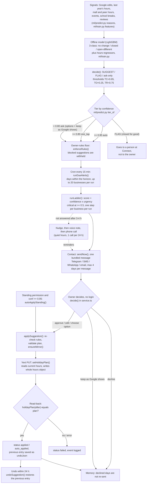

# FonectaGuard architecture (one page)

The loop is **detect → suggest → contact → owner decides → write to Yext, read back, offer undo**. Nothing is written to the listing source without an owner decision, except for owners with standing permission and a model confidence of at least 0.95 (`src/lib/connect/service.ts`, `autoApplyStanding`). Those changes are applied at once, the owner is told, and undo is offered.

## 1. The guardian loop

Owner free text, photos and voice take a second path into the same floor and the same write step. `handleOwnerInput()` in `src/lib/connect/agent.ts` proposes typed changes, `validateChange()` and `changeViolation()` check them, and `applyChange()` re-checks the rules at apply time, writes, and stores undo data.

## 2. Box to file

| Box | Implemented in |
|---|---|
| Signals, features, model training (out-of-fold, `GroupKFold(5)`) | `ml/train.py` |
| Final fit, SUGGEST/FLAG/ask decisions, tiers, reasons, cost estimate; writes `suggestions_2026.json` | `ml/predict.py` |
| Seed export of that JSON into the app | `ml/export_seed.py` (referenced; not read in detail) |
| Owner-rules floor (types, `planViolation`, `changeViolation`, load/add/remove) | `src/lib/connect/rules.ts` |
| Floor applied to outgoing suggestions and auto-applies | `enforceRules()` in `src/lib/connect/service.ts` |
| 15-minute cron | `wrangler.jsonc` (`"crons": ["*/15 * * * *"]`) and `scheduled()` in `worker.ts` |
| Criticality score, escalation ladder, `runDueAlerts` | `src/lib/connect/critical.ts` |
| Contact (bundle, channels, opt-out check, auto-apply notice) | `src/lib/connect/deliver.ts` (`sendNow`), `createMessage` in `service.ts` |
| WhatsApp channel (Vonage Messages API, demo number only) | `src/lib/connect/whatsapp.ts` |
| Owner decision buttons, edit text, undo, voice/photo entry (Telegram) | `src/lib/connect/telegram-bot.ts`, `decide()` in `service.ts` |
| Free-text / voice / photo agent (Gemini for photos, default model fallback) | `src/lib/connect/agent.ts` |
| Yext reads and writes, mirror, restore helpers | `src/lib/connect/yext.ts` |
| Write, read-back verification, undo window (24 h) | `applySuggestion`, `undoSuggestion` in `service.ts` |
| Issue Radar (what needs attention, plus its own "not watched yet") | `src/lib/connect/radar.ts` |

## 3. What is not covered

- **The model is offline.** `ml/predict.py` is a batch job that writes JSON and CSV. The 15-minute cron only drives contact and escalation. It does not retrain or re-predict (`worker.ts`, `ml/predict.py`).
- **Special-day hours only.** The model decides opening hours for special days. README says photo, phone and address detection cannot be validated on this data (README, "What we tried that didn't work"). Those agent change types are covered by tests for safety, not for detection accuracy.
- **Not watched yet:** photo freshness and quality, review replies, menu and price changes (`coverage.notYet` in `src/lib/connect/radar.ts`). README also says outdated images are on the roadmap only.
- **Closed-for-good days are not auto-handled.** A `FLAG` is surfaced to a person at Connect and never changed automatically (`radar.ts`, `ml/train.py` `decide`).
- **Demo-only delivery.** SMS, WhatsApp, email and calls go only to `DEMO_PHONE` / `DEMO_EMAIL`. Calls never go to numbers in the data (`deliver.ts`, `whatsapp.ts`, `critical.ts` `doCall`). Real per-owner contact on those channels is not wired. Telegram uses the owner's linked chat.
- **Telephony is optional.** With no 46elks/Twilio account or demo number, the call step is skipped (`critical.ts`).
- **Yext sandbox, one shared entity.** `YEXT_BASE_URL` defaults to `sbx-api.yextapis.com`, and `mirrorBusiness` rewrites one entity to look like each demo business (`yext.ts`, `service.ts` `ensureMirror`). Production multi-entity mapping is not implemented. The read-back checks Yext's response, not what each publisher (Google etc.) has actually published.
- **Undo is time-limited** to 24 h for hour suggestions (`UNDO_WINDOW_MS` in `service.ts`).
- **Weak spot in accuracy.** For new customers about half of the days are decided by peers alone (about 55% state-correct), which is where most lost score comes from (README). Auto tier is 94.5% exact out-of-fold, so below 0.95 the app always asks (`service.ts`).
- **Scorer is a port.** The organiser's scorer was not run. Its published rules were ported (README).
